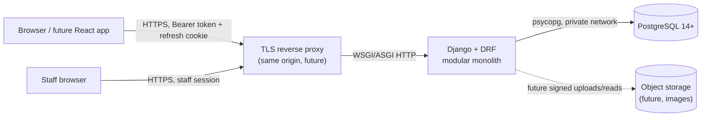
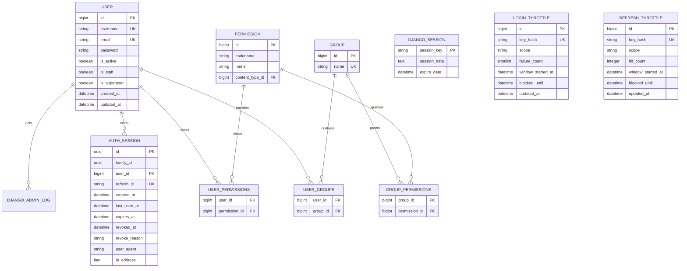
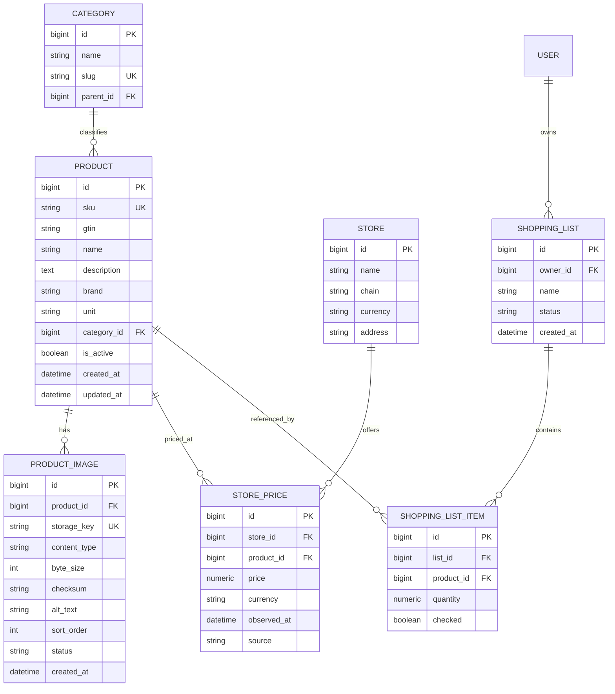

# Architecture — Milestone 1

## Purpose and scope

Milestone 1 establishes a secure backend foundation for MyTrolley: a Django
REST Framework application backed by PostgreSQL, with JWT token authentication,
role-based authorization, operational health endpoints, a consistent error
contract and a reproducible quality gate. Product, catalog, image, store and
shopping-list behaviour is designed here but intentionally not implemented yet.

The solution is a modular monolith. It uses no Docker, microservices, Redis,
SQLite or YAML-based application configuration.

## System context



Milestone 1 has no frontend. The reserved `frontend/` directory is not
implemented. The API is versioned under `/api/v1` so later clients (React,
Swift) can rely on explicit contracts.

## Backend components

| Component | Responsibility |
|---|---|
| `config/settings/base.py` | Shared settings, security headers, sessions/CSRF, DRF defaults, limits, logging |
| `config/settings/development.py` | Local `DEBUG=True`, local hosts, docs URL registration, optional anonymous docs for login testing |
| `config/settings/production.py` | Secure cookies, HTTPS redirect, HSTS, explicit hosts, startup validation |
| `config/settings/test.py` | PostgreSQL tests, deterministic fast hashing, docs enabled |
| `config/env.py` | Strict env parsing; never renders secret values |
| `config/validation.py` | Pure production configuration validation |
| `config/urls.py` | Health, auth, schema/docs with staff-only production access, configurable admin |
| `config/views.py` | Django-level JSON 400/403/404/500 and CSRF failure handling |
| `core/middleware.py` | Request ID, safe request logging, optional admin IP allowlist |
| `core/exception_handler.py` | Normalizes DRF/Django/unexpected exceptions to one envelope |
| `core/parsers.py` | Bounded JSON parser; rejects oversized or malformed bodies early |
| `core/health.py` | Bounded `SELECT 1` readiness probe |
| `core/security.py` | Client IP resolution with explicit proxy trust |
| `accounts/models.py` | Custom user, `AuthSession`, login and refresh throttle tables |
| `accounts/roles.py` | Idempotent group/permission seeding |
| `accounts/throttling.py` | PostgreSQL-backed login and refresh abuse protection |
| `accounts/tokens.py` | Access/refresh issuance, rotation, reuse detection, revocation |
| `accounts/authentication.py` | Session-aware Bearer validation |
| `accounts/views.py` | Login, CSRF cookie issuance, refresh, logout, current user |

## Request lifecycle

```text
Request
  → RequestIdMiddleware            attach validated/generated request ID
  → RequestLoggingMiddleware       status, path, duration; traceback on unhandled error
  → SecurityMiddleware             HTTPS redirect/HSTS in production
  → AdminIpAllowlistMiddleware     optional network gate for admin prefix
  → SessionMiddleware              load database session (Django admin only)
  → CommonMiddleware
  → CsrfViewMiddleware             enforce CSRF for admin; refresh checks it explicitly
  → AuthenticationMiddleware       attach admin session user
  → MessageMiddleware / XFrameOptionsMiddleware
  → URL resolver
  → DRF authentication (SessionAwareJWTAuthentication)
  → DRF permission (default IsAuthenticated, explicit public exceptions)
  → View / serializer validation
  → Exception handler             stable JSON envelope, safe message, request ID
  → Response                       X-Request-ID plus optional no-store
```

The API uses `APPEND_SLASH=False` and JSON-only parsers/renderers. Unknown API
routes still receive the JSON envelope through Django-level handlers.

## Data model — milestone 1

Django's tables are shown only where they matter to the design.



`LOGIN_THROTTLE` is deliberately independent of `USER`: it also counts unknown
usernames and IP addresses, and stores only HMAC-SHA256 keys. `AUTH_SESSION`
backs access-token revocation: the `sid` claim must resolve to a live row.
Throttle and auth-session rows are database rows, so every application process
shares them. `DJANGO_SESSION` remains for the Django admin only.

### Role matrix

| Capability | Administrator | DataEntry | Authenticated, ungrouped |
|---|---:|---:|---:|
| Authenticate and read own profile | Yes | Yes | Yes |
| Access Django admin | Staff flag only | No by default | No |
| `accounts.manage_users` | Yes | No | No |
| `accounts.manage_catalog` | Yes | Yes | No |
| Future user/role management | Yes | No | No |
| Future catalog/product writes | Yes | Yes | No |
| Future store/price writes | Yes (proposed) | No (proposed) | No |

The permission class reads a view's `permission_required` codename and checks
the active authenticated user. Missing permission configuration fails closed.

## Authentication and token design

```text
POST /auth/login/ (JSON username/password)
  → credential validation (generic failure)
  → database login throttle check
  → Django authenticate
  → create AuthSession (sid, family, refresh JTI, absolute expiry)
  → short-lived access JWT + HttpOnly refresh cookie + readable CSRF cookie
GET /auth/me/ → Bearer verification, sid lookup, active-user/session check
POST /auth/refresh/ (cookie + X-CSRFToken, or body token)
  → validate signature/expiry/issuer/audience/type
  → lock session, compare stored JTI
  → rotate JTI and issue a new access token + cookie
  → replay of a consumed JTI revokes the token family
POST /auth/logout/ (Bearer)
  → revoke every AuthSession for the caller
  → clear refresh cookie
  → 200 with an explicit message
```

The access token is held in client memory only; the refresh token is an
`HttpOnly` cookie scoped to `/api/v1/auth/`, `Secure` and `SameSite=Strict`
outside development. Refresh rotation is capped by the session's absolute
expiry. The CSRF cookie remains readable by JavaScript because cookie-authorized
refresh must copy it into `X-CSRFToken`. Django admin keeps its own session
cookie and CSRF protection.

Refresh is intentionally excluded from the public schema and Swagger UI while
remaining callable. Hiding it is a documentation choice, not a security
boundary.

## Trust boundaries

1. **Browser ↔ reverse proxy.** TLS terminates here in production. The client
   is untrusted. Cookies are scoped to the application host; the deployment
   must keep the React app and API on one origin.
2. **Reverse proxy ↔ Django.** Django trusts `X-Forwarded-Proto` and
   `X-Forwarded-For` only when `TRUST_PROXY_HEADERS=true`. The proxy must
   overwrite client-supplied values. Direct deployments leave trust disabled.
3. **Django ↔ PostgreSQL.** Database credentials exist only in the backend
   environment. Production requires TLS (`DB_SSLMODE=require` or stricter) and
   a private network path. The application role should own only the application
   database and should not be a PostgreSQL superuser.
4. **Staff ↔ admin/docs.** Django admin is staff-only. The admin path is
   non-default in production and can be restricted by source network.
   Swagger/schema are staff-only and disabled by default in production.
   Development may expose the docs anonymously (`API_DOCS_PUBLIC=true`) to test
   the login flow; this changes documentation visibility only.
5. **Future object storage.** Product images will cross into object storage.
   That boundary needs content validation, malware scanning, re-encoding,
   signed URLs and least-privilege bucket credentials.
6. **CI / secrets.** CI uses ephemeral PostgreSQL credentials and a test-only
   signing key. Real `.env` values and production secrets never enter the
   repository or CI logs.

## Failure behaviour

| Failure | Behaviour |
|---|---|
| Missing/short/insecure `DJANGO_SECRET_KEY` | Startup fails with variable name and reason; value never printed |
| Invalid production security config | `ImproperlyConfigured` lists safe errors; process does not start |
| PostgreSQL unavailable | Liveness still `200`; readiness `503` with a generic body |
| Invalid JSON / oversized body | `400 INVALID_JSON` / `413 PAYLOAD_TOO_LARGE`; parser text not exposed |
| Unexpected view exception | `500 INTERNAL_ERROR`; traceback only in server logs with request ID |
| Repeated login failures | `429 RATE_LIMITED` with `Retry-After`; cooldown shared across processes |
| CSRF failure | `403 CSRF_FAILED` for `/api/`; HTML 403 for admin |

## Future product, catalog, image and store design

The following is a design direction, not milestone-1 code.

### Proposed domain model



### Design rules for later milestones

- **Money:** use PostgreSQL `numeric`/Python `Decimal`, never floats. Store the
  currency with each price. Define rounding and display rules explicitly.
- **Catalog authorization:** `DataEntry` may create/update products and images;
  `Administrator` additionally manages users, stores and destructive actions.
  Every privileged write is permission-checked server-side and audited.
- **Images:** upload to object storage through a storage abstraction, not the
  database. Limit byte size and dimensions; verify magic bytes, allow only
  raster formats, strip EXIF, re-encode, scan for malware and serve through
  short-lived signed URLs. Never trust the client filename or content type.
- **Soft deletion:** products referenced by lists/prices should be deactivated
  rather than hard-deleted, preserving historical totals.
- **Price history:** append `STORE_PRICE` observations; do not overwrite the
  previous price. Current price is a query over the latest observation.
- **Shopping lists:** totals are computed server-side from current prices and
  quantities, with an explicit snapshot policy for historical lists.
- **Concurrency:** use database constraints and `select_for_update` for
  destructive or counter-like operations; avoid process-local state.
- **API evolution:** keep `/api/v1` additive; document breaking changes and
  add a new version rather than silently changing response shapes.

### Milestone plan

| Milestone | Scope | Exit criteria |
|---|---|---|
| 1 (current) | Auth, roles, health, errors, config, tests, CI, docs | Green lint/type/tests/coverage; staff-only production docs; development Swagger login testing; verified auth flow |
| 2 | Categories/products, validation, permissions, audit, tests | CRUD contract, authorization matrix, migration and API tests |
| 3 | Image upload/storage abstraction, scanning/re-encoding, signed access | Malicious/oversized uploads rejected; storage credentials least privilege |
| 4 | Stores, price observations, shopping lists, totals | Decimal money, history, concurrency and permission tests |
| 5 | React dashboard, Swift client, deployment hardening | Same-origin auth flow, CSP review, TLS/HSTS validation, runbooks |

## Key decisions and trade-offs

- **Django 5.2 LTS instead of 6.x:** the installed PostgreSQL is 14.18 and
  Django 6.x requires PostgreSQL 15+. Django 5.2 is supported and compatible
  with Python 3.14.
- **JWT access tokens backed by `AuthSession` instead of stateless JWT or
  session cookies:** the API needs short-lived bearer credentials for future
  React/iOS clients, but immediate revocation still matters. The `sid` claim
  resolves against a database row on every request, so logout, password change
  and deactivation take effect at once. The trade-off is one indexed database
  read per authenticated request plus rotation/cleanup machinery; sticky
  deployment assumptions are avoided because the rows live in PostgreSQL.
- **PostgreSQL throttle instead of cache/Redis:** satisfies cross-process abuse
  protection without adding Redis. The trade-off is write load on failed logins
  and periodic cleanup (`prune_login_throttles`).
- **Groups/permissions instead of boolean roles:** inspectable, extensible and
  compatible with Django admin. Role names are stable; permission codenames are
  the authorization contract.
- **No CORS package:** the deployment is same-origin. Adding permissive CORS
  would enlarge the CSRF/session attack surface without a current need.
- **Modular monolith:** appropriate for the assessment and easy to operate; the
  module boundaries leave room for later extraction without premature services.
